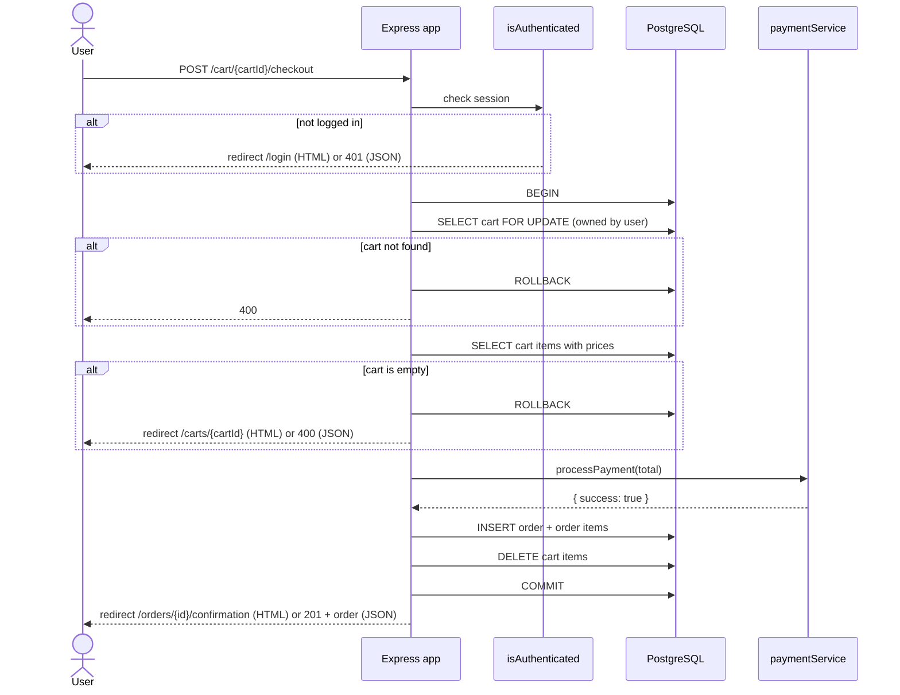
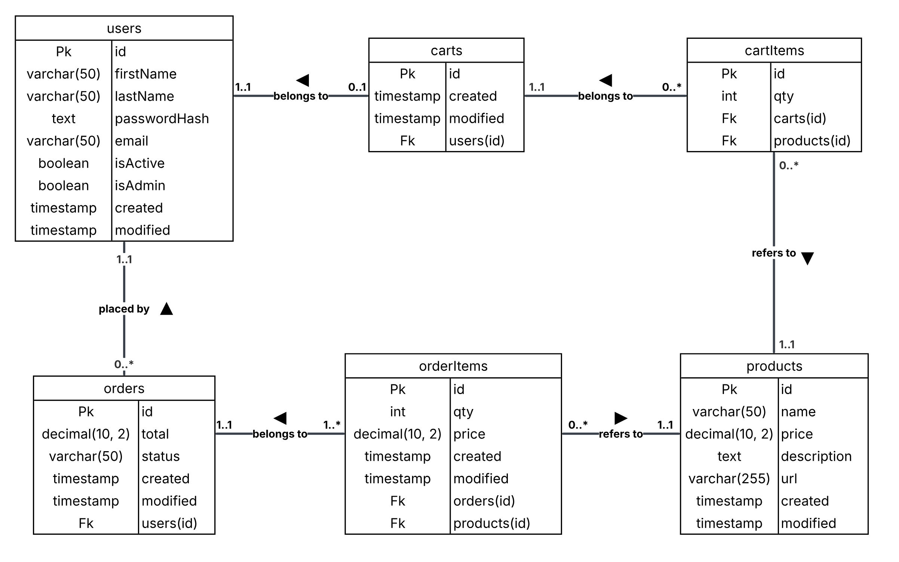

# E-commerce App

A full-stack e-commerce application built with Node.js, Express and PostgreSQL. Users can register, log in, browse a product catalogue, manage a shopping cart, check out with a mocked payment and look back at their order history. The application serves server-rendered pages with EJS and a JSON REST API from the same routes, and the API is documented with Swagger UI.

## Motivation

The project was built to practise designing and building a complete web application end to end: modelling a relational database, building a REST API with authentication and authorization, rendering pages on the server, and backing the work with an automated test suite running in CI.

## Development approach

I started by breaking my project down into abstract epics. These epics were later associated with issues that together defined each epic’s *definition of done*.

During the project I adopted a test-driven workflow. Unit tests were generated using the AI tool [agent-instructions](https://github.com/wbern/agent-instructions). I instructed the AI to produce one failing test at a time, following the Red phase of the Red–Green–Refactor cycle; it was then my responsibility to make the test pass. If I got stuck, I asked my AI agent to guide me using a Socratic approach.

This method reinforced the discipline of implementing focused, incremental changes and helped me form a clear understanding of each component’s expected behavior before writing any production code.

When I opened a pull request, I used the AI review tool CodeRabbit to identify weaknesses in the code.

## Features

- User registration with bcrypt-hashed passwords and duplicate email detection (409)
- Login and logout with Passport (local strategy) and sessions stored in PostgreSQL
- Protected routes: browsers are redirected to `/login`, API clients get `401`
- Product catalogue with a home page and product detail pages
- Product management (create, update, delete) restricted to admin users
- Account page where users can view, edit and delete their own profile
- One shopping cart per user: add products (quantities increase instead of duplicating), remove products, see the total
- Checkout in a single database transaction with a row lock on the cart, a mocked payment, order creation and an emptied cart
- Order confirmation, order history and order detail pages
- Content negotiation: the same routes serve HTML to browsers and JSON to API clients
- Interactive API documentation with Swagger UI at `/api-docs`
- Custom 404 and 500 error pages
- Seed script that imports a demo catalogue from [DummyJSON](https://dummyjson.com/products)

## Tech/framework used

**Built with:**

- [Node.js](https://nodejs.org/) (CommonJS)
- [Express 5](https://expressjs.com/)
- [PostgreSQL](https://www.postgresql.org/) with [node-postgres (`pg`)](https://node-postgres.com/)
- [EJS](https://ejs.co/) for server-side rendering
- [Passport](https://www.passportjs.org/) with `passport-local` for authentication
- [express-session](https://github.com/expressjs/session) with [connect-pg-simple](https://github.com/voxpelli/node-connect-pg-simple) as session store
- [bcrypt](https://github.com/kelektiv/node.bcrypt.js) for password hashing
- [dotenv](https://github.com/motdotla/dotenv) for configuration
- [swagger-jsdoc](https://github.com/Surnet/swagger-jsdoc) and [swagger-ui-express](https://github.com/scottie1984/swagger-ui-express) for API documentation
- [Neon](https://neon.tech/) configuration (`neon.ts`) for hosted Postgres branches

**Tested with:**

- [Jest](https://jestjs.io/)
- [Supertest](https://github.com/ladjs/supertest)
- [GitHub Actions](https://github.com/features/actions) with a PostgreSQL 16 service container

## Sequence diagram

Checkout flow (`POST /cart/{cartId}/checkout`):



## ER diagram 


## Code style

No linter or formatter (ESLint, Prettier) is configured in the project. The code follows these conventions:

- CommonJS modules, two-space indentation and single quotes
- Layered structure: `routes/` → `controllers/` → `services/` → `db/`
- OpenAPI annotations as JSDoc comments directly above the routes
- Commit messages follow [Conventional Commits](https://www.conventionalcommits.org/) (`feat:`, `fix:`, `test:`, `build:` …)

## Installation

1. **Clone the repository**

   ```bash
   git clone git@github.com:hevolx/e-commerce-app.git
   cd e-commerce-app
   ```

2. **Install dependencies**

   ```bash
   npm install
   ```

3. **Create a PostgreSQL database**, either locally or hosted (for example on Neon).

4. **Configure the environment.** Create a `.env` file in the project root (see [Environment variables](#environment-variables)):

   ```env
   PORT=3000
   PGHOST=localhost
   PGUSER=postgres
   PGPASSWORD=your-password
   PGDATABASE=ecommerce
   PGPORT=5432
   SESSION_SECRET=a-long-random-string
   SALT_ROUNDS=10
   ```

5. **Create the tables and seed products**

   ```bash
   npm run seed:products
   ```

   This runs `db/setupDatabase.js` (creates the tables, including the session table) and then `db/seedProducts.js` (imports the demo catalogue). Both are safe to run again. To create only the tables, run `node db/setupDatabase.js`.

6. **Start the server**

   ```bash
   npm start
   ```

   The app runs on `http://localhost:3000` (or the port set in `PORT`).

## Tests

The tests run against a real PostgreSQL database, so set up `.env` and the schema first (step 4–5 above).

```bash
npm test
```

This runs Jest with `--runInBand` so the test files run one at a time against the shared database. To run a single test file:

```bash
npx jest test/checkout.test.js
```

The [Test suite](.github/workflows/test.yml) workflow runs the tests on GitHub Actions for every pull request to `main`, against a PostgreSQL 16 service container.

## Usage examples

**In the browser**

1. Open `http://localhost:3000` to see the product catalogue.
2. Register at `/register`, then log in at `/login`.
3. Open a product and add it to your cart.
4. Open the cart from the navigation, go to checkout and place the order.
5. See the confirmation page, then look back at your orders under `/order-history`.
6. Edit or delete your profile under `/account`.


## API reference

Full, interactive documentation is available at **`/api-docs`** (Swagger UI) while the server is running.

**Auth:** *No* = public, *User* = logged in, *Admin* = logged in with `isAdmin = true`. Routes that need a login redirect browsers to `/login` and answer API clients with `401`.

### JSON API

| Method | Path | Auth | Description |
| --- | --- | --- | --- |
| `POST` | `/register` | No | Register a new user (`email`, `password`, `firstName`, `lastName`) |
| `POST` | `/login` | No | Log in with `email` and `password` |
| `POST` | `/logout` | No | Log out and end the session |
| `GET` | `/users` | Admin | List all users |
| `GET` | `/users/{userId}` | User | Get a user profile (own profile, or any as admin) |
| `PUT` | `/users/{userId}` | User | Update your own profile |
| `DELETE` | `/users/{userId}` | User | Delete your own account (any account as admin) |
| `GET` | `/products` | No | List all products |
| `GET` | `/products/{productId}` | No | Get a product by id |
| `POST` | `/products` | Admin | Create a product (`name`, `price`, `description`) |
| `PUT` | `/products/{productId}` | Admin | Update a product |
| `DELETE` | `/products/{productId}` | Admin | Delete a product |
| `POST` | `/cart` | User | Create a cart for the logged-in user |
| `POST` | `/cart/{cartId}` | User | Add a product to the cart (`productId`) |
| `GET` | `/cart/{cartId}` | User | Get the cart contents with total |
| `DELETE` | `/cart/{cartId}/items/{itemId}` | User | Remove a product from the cart |
| `POST` | `/cart/{cartId}/checkout` | User | Check out the cart and create an order |
| `GET` | `/orders` | User | List your orders |
| `GET` | `/orders/{orderId}` | User | Get the details of one of your orders |

### Pages

| Method | Path | Auth | Description |
| --- | --- | --- | --- |
| `GET` | `/` | No | Home page with all products |
| `GET` | `/product/{id}` | No | Product detail page |
| `GET` | `/register` | No | Registration form |
| `GET` | `/login` | No | Login form |
| `GET` | `/account` | User | Account page |
| `POST` | `/account` | User | Save profile changes |
| `POST` | `/account/delete` | User | Delete your account |
| `GET` | `/cart` | User | Redirect to your cart page |
| `GET` | `/carts/{id}` | User | Cart page |
| `POST` | `/add-to-cart` | User | Add a product to your own cart (form) |
| `POST` | `/cart/{cartId}/items/{itemId}/delete` | User | Remove a product from the cart (form) |
| `GET` | `/carts/{id}/checkout` | User | Checkout page |
| `GET` | `/orders/{id}/confirmation` | User | Order confirmation page |
| `GET` | `/order-history` | User | Order history |
| `GET` | `/order-history/{id}` | User | Order detail page |
| `GET` | `/api-docs` | No | Swagger UI |

## Environment variables

| Name | Required | Description |
| --- | --- | --- |
| `PORT` | Optional | Port the server listens on. Defaults to `3000`. |
| `PGHOST` | Required | PostgreSQL host |
| `PGPORT` | Required | PostgreSQL port (usually `5432`) |
| `PGUSER` | Required | PostgreSQL user |
| `PGPASSWORD` | Required | PostgreSQL password |
| `PGDATABASE` | Required | PostgreSQL database name |
| `SESSION_SECRET` | Required | Secret used to sign the session cookie |
| `SALT_ROUNDS` | Required | Number of bcrypt salt rounds used when hashing passwords (e.g. `10`) |
| `NODE_ENV` | Optional | Set to `production` to send the session cookie only over HTTPS |

## License

MIT @ Love Holmgren
